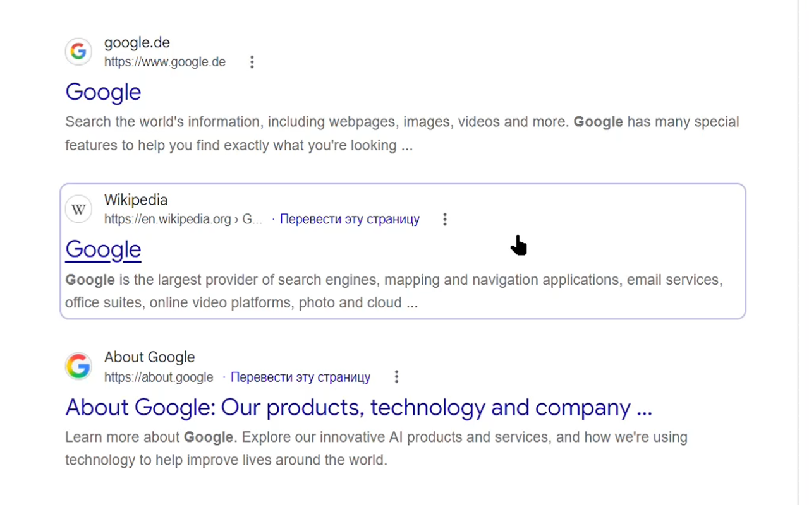

#  Better Google Search

 

I was always annoyed that Google Search pages started using "G" icon, which doesn't resemble anything related to the search itself. So I wrote this tiny extension which replaces it with a themed magnifying glass icon, similar to a Bing one. 

In addition, it provides few smaller tweaks to make using the service a little easier. For now only works on [google.com](google.com) domains, not local ones ([google.ru](google.ru), [google.es](google.es) etc).

### Features
- Change favicon to a magnifying glass icon
- Make whole search result clickable, like in DuckDuckGo
- Keyboard navigation between results with arrow keys. Spacebar/Enter to select the current one
- Remove https:// from URLs

All options can be toggled from the settings page.

### Development history
This script was originally called [Google Search Tweaker](https://github.com/emvaized/google-tiles-extension), which I created back in 2021. Eventually I abandoned it because it became tedious to keep up with constantly changing layout of the Google search page. With version `3.0` I rewrote it from scratch as much simpler and faster script. It is super lightweight, and can now also be used as a Userscript.

## Support
If you really enjoy this product, please consider supporting its further development by making a small donation! 

 &nbsp;  &nbsp;  